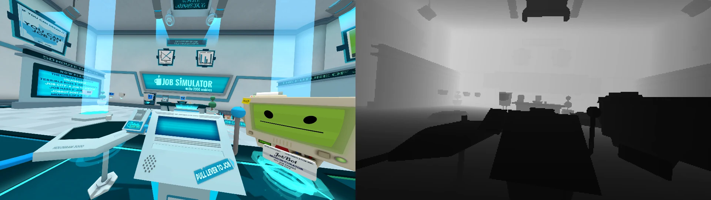
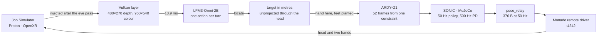

<p align="center">
  
</p>

# Clank

One 2B vision-language model does every model call in this loop. It hears the instructor, reads the game's own frame and depth, decides what to do next, finds the object it needs, and hands the body a single command. A simulated Unitree G1 then carries that out with a generated motion, inside a commercial VR game that was never meant to be driven by either.

The round trip: the game renders a frame → a Vulkan layer reads depth and colour from inside the render pass, 13.9 ms → the model decides → the located point becomes a motion constraint → the body tracks it at 50 Hz → the pose relay writes head and hands back into the game's OpenXR session. No headset, no controllers, no game files touched.

The question is how much of a task a 2B model can carry when it has no privileged view of the world. It gets one picture, one sentence, and what happened last time; there is no task list and no goal written by me. The game answers back, because either the card ends up in the hand or it does not.


*Run `190131-679de2`, 13 November 2026: nine model calls, one grab. The diary's last line is `no word from JobBot after the grab`, and that line is wrong — the run's own audio has him asking for a job cartridge at 42 s, and the ear missed it.*

## The brain: one 2B model, every call in the loop

LFM3-Omni-2B, Q8_0, served by llama.cpp on `:11434`. Not one call in this loop goes anywhere else: two planner calls and seven locator calls in the run above, plus one per utterance to hear it, counted on the model server's log. It is the same checkpoint for every job, and that is the design rather than an accident of the build.

### It sees

The picture is the game's own. The layer copies the 3840×1080 depth target the final eye pass wrote, converts reversed-Z to metres on the GPU, and leaves a 480×270 float depth map and a 960×540 colour image in a seqlock-protected mmap. The model gets the colour still, and the depth is what keeps the pixel honest: it is how a point in the picture becomes a point in the room.



### It hears

One call per utterance, the wav base64'd into the same chat endpoint: **238 ms prefill, 310 ms decode** for a line of JobBot's. Hearing stays separate from deciding on purpose. One call asked for both the words and a decision produced a decision that ignored the words, so the transcript is always its own call and the words are handed to the next one as text.

### It decides

This is the whole prompt, the picture aside — the earlier turns' speech does not come with it, only the last outcome:

```text
You are a robot playing a VR game. JobBot said: "Hey, Gilman, take my card."

heard: Hey, Gilman, take my card.
self:  left=open right=open yaw=0.00 glow=unknown ghost=unknown
last:  done

No further instruction was given. Decide what you are trying to do next, and
where, from what you can see. The things you can pick up are a card, a job
cartridge and a lever; the console is where they go. Reply with JSON only, no
explanation: {"goal": "the outcome you want", "object": "the thing you act on or
are holding", "destination": "the name of the visible thing it goes into, or
none", "side": "left|right"}
```

The answer is a sentence in its own words plus the fields around it:

```json
{"goal": "take the card from JobBot", "object": "card", "destination": "none", "side": "right"}
```

**It does not pick a verb, and that is the finding.** The earlier design gave it an action list; asked to pick from one, it answered `hold` or `release` on 4 of 4 stills and never once `grab`. Asked instead what it is trying to do, it said "take the JobBot card" on 4 of 4. So the shape of the question is the measurement: the model states the goal, and the verb is read out of the model's own sentence in code. `brain.py` still carries the constitution and the six-verb schema that design used, and the replay view that re-renders a finished diary still uses them; the loop sends neither. The verb list is exactly what stopped it choosing.

### It finds

`spike/wbc_game/locate.py`, same model, seven calls in the run above. One quadrant question about the whole frame, then a pixel question about that quadrant grown 15% so a thing on the seam is not sliced, then five box reads, then a description. The five reads and the check cost **2.32–2.94 s** and put the card **21.0 px** from hand-marked truth on a live frame. The quadrant comes first because this model collapses any image-global grid toward the centre: **3/12** on thirds, **0/12** on a nine-cell pick, **0/12** on a 4×4.

The pixel is not tracked between ticks, because it cannot be. The head will not hold a commanded pose: held against one target for ten seconds it wobbled **11.7° of yaw**, and the card moved 1009 → 1122 → 865 → 1007 px inside a single four-command reach ([`research/reach-placement.md`](research/reach-placement.md)). So the target is unprojected through the measured head into metres once and projected back every tick, and the pixel the hand aims at is re-derived rather than remembered.

**Identity is decided in code.** Colour is not identity: a box described as a "green robot computer" matched "job cartridge" on the shared colour word and pointed at a monitor. The model will refuse when it is offered the chance — given `{"none": true}` as an option it refused **5/5** reads for an absent noun — but it will not refuse a noun it believes in, so the match is a vocabulary comparison in `describe_matches()`, and an unknown noun refuses even when the box was right.

### It commands

The goal becomes an `Intent`: a skill the adapter knows, a side and a target. The adapter compiles that and nothing else — the model never writes a joint, a pose or a pixel. A hand action becomes a constraint, right hand at the located point with the feet planted; ARDY-G1 writes 52 frames at 25 Hz; SONIC tracks them at 50 Hz on a 500 Hz PD loop.

Three more things that measuring it changed:

- **It invents work.** The first turn of the run above heard an introduction — "welcome to the job simulator, my name is JobBot" — and planned `place(job cartridge into console)`, a chore nobody had given it. The schema caught it (`place needs a side`) and it held. That is the honest account: the loop refused the plan, the model did not withdraw it.
- **It copies its prompt.** Put `release` first in an action list and it answers `release`, pipe character included. This is why the live prompt has no action list for it to copy.
- **Refusing does not teach it.** Told `reach right card -> not_located`, it re-issued `reach` on **3 of 3** stills, and writing the rule into the prompt changed nothing. So when an act needs a pixel the loop does not have, the loop runs the search itself rather than trusting the model to remember.

Every turn is one record in a diary: what was heard, what was said, what was done, what it was told back. The panel in the first image is that file. The nouns the prompt offers are the ones the locator can confirm, and a test fails if those two lists drift apart.

## Three models, and nothing else

| Model | Its job | Where it comes from |
|---|---|---|
| **LFM3-Omni-2B** (Q8_0) | hears, decides, finds, verifies — every call above | Liquid AI, llama.cpp |
| **GEAR-SONIC** | tracks a reference motion at 50 Hz, 500 Hz PD | NVIDIA NVlabs, ONNX Runtime |
| **ARDY-G1-RP** | turns one constraint into 52 frames at 25 Hz | NVIDIA, PyTorch, CUDA |

The 2B model is the brain. The other two are the hands: one invents a motion, the other keeps the body upright while it runs. I did not train, fine-tune or quantise any of them; the work here is the loop, the geometry, and the plumbing that makes three published models cooperate on one 8 GB card. Python 3 (standard library only) for the application in `clank/`; MuJoCo 3.17 in the spikes, where one 20 ms control tick costs 6.8 ms of encoder, decoder and physics when the ONNX runtime takes 19 cores, or 17.66 ms pinned to one thread ([`research/wbc-policy-proposal.md`](research/wbc-policy-proposal.md)); NixOS, Steam and Proton; Monado with its `remote` driver; a Vulkan layer in C and GLSL.

Solo project. `pi` was the coding agent and DeepSeek V4.1 Flash the model that typed most of the code. The perception chain — the depth buffer, unprojected to metres, projected back to a pixel — and the shape of the loop are mine. The `Source` column below is there instead of a promise, because the numbers are the argument.

## Architecture



The game is both the sensor and the actuator: the layer reads the frame it has already rendered, and the pose relay writes the next one. There is one simulation. The achieved `mjData` poses go out as 376-byte packets, and the same poses draw the body tile in the image above, so the game and the operator are looking at the same robot rather than two lookalikes.

## Decisions and tradeoffs

**Inject into the render pass, not a capture.** RenderDoc replays a frame in about 16 s; the layer costs 13 ms. The price is C and GLSL inside the game's render pass, and knowing that the target is written twice per frame, once by a clear pass and once by a load pass that adds the other eye and its glow. Only the load pass may be injected. Inject both and the preview alternates between dim and bright frames.

**Generate the reach instead of hand-writing and tracking it.** Hand-writing a reference and asking the policy to follow it left residuals of 49–79 mm, because the policy answers a reference with something of its own. A constraint into a motion prior gets 16.1 mm commanded and 12.2 mm achieved. The cost is a CUDA dependency, a right hand only, and a preflight that can refuse, so the scripted path still exists as the fallback.

**Relay the state file the viewer already writes.** A second pose client would have been easy and would have meant two simulations: the tile showing one body and the game another, and every screenshot a quiet lie. The relay is standard-library, reads `body_state.json`, and holds the last pose with a `stale` flag instead of freezing silently.

**A crop per turn, not a bigger locator per turn.** On a full frame, the grounded VL model found the card to 22 px where the 2B model was 360 px off, but the same crop took it 19.3 s against 0.73 s. The loop needs an answer per turn, so the 2B model stays on a crop it can read, and identity stays a comparison in code because that is the only thing that has measured above chance.

## Results

| Hop | Result | Conditions | Source |
|---|---|---|---|
| See | layer **13.9 ms** median, p95 24.8; transport 1.4 ms; 29.8 fps | 480×270 depth, 960×540 colour | `research/evidence/depth-stream/latency.txt` |
| Hear | **238 ms** prefill + 310 ms decode | one utterance, 2B model, llama.cpp | `research/hearing.md` |
| Plan | **210 ms** prompt + 203 ms decode | one still plus the sentence | `research/brain-tools.md` |
| Locate | card **21.0 px** (21 mm at 0.332 m), lever 5.9 px | one live frame, five box reads | `research/locate.md` |
| Generate | **16.1 mm** commanded, **12.2 mm** achieved on the glove, 0.313 s, 0.94 GB | game and depth layer live, 52 frames | `research/evidence/ardy-in-the-loop/README.md` |
| Drive the game | the achieved torso and wrists drive the HMD and the controllers: `look_left` **−28.6°**, `look_right` **+54.3°** from the body's **−86.8°** baseline | mode `body`, 50 Hz relay | [`docs/archive/specs/2026-10-30-targeting-adapter.md`](docs/archive/specs/2026-10-30-targeting-adapter.md) |
| Walk | **39.79 m** path in 60 s at 0.663 m/s, no fall, yaw drift −2.1° | SONIC default, headless CPU | `research/sonic-gate-results.md` |
| Co-residency | **44.2 Hz** beside the game against 44.5 Hz alone, +177 MiB | one 8 GB card, two views | `research/r6-co-residency.md` |

## Limitations

- **Nobody has played it.** The body took a card and held it; no level has been cleared. The run above ends on `no word from JobBot after the grab`, and the recording contradicts it: the ear missed the line, not the game.
- **The body does not walk in-game.** It is clip-anchored: one generated window reaches, it does not step, so anything out of arm's reach is not attempted.
- **It runs at 44.2 Hz against a 50 Hz design point** with the game up. The tick advances exactly 20 ms of simulated time, so the shortfall is real: the game sees 0.89× real time.
- **The torso does not turn to look.** It started 63.9° off the card and the reach did not turn it, so the body reaches sideways at a target it is facing away from.
- **The clasp threshold is a guess.** 80 mm has fired twice, at 60 and 78 mm, and has never been swept either way.
- **The model is not reliable about its own tools.** One run planned `reach(the display interface)` again and again, located nothing, and never acted on the card.
- **Three of the five fields in the `self:` line are constants.** The loop passes the hands and the last outcome; `yaw`, `glow` and `ghost` sit at their defaults, because nothing computes them yet.
- **There is no transcript yet.** Each plan sees the last outcome and the newest sentence, not the whole conversation.
- **Controller orientation is unverified.** Positions are exact, but the wrist frame is not an OpenXR grip, so the in-game aim may be rotated by a fixed offset.

## Quick start

You need NixOS with Steam, your own copy of *Job Simulator* (not included, never will be), Monado built with the `remote` driver, an NVIDIA card with 8 GB, and llama.cpp serving the 2B model on port 11434. The model's flags matter and are pinned in [`AGENTS.md`](AGENTS.md); a server started with defaults answers differently.

```bash
git clone <this repo> && cd Clank
cp config.example.toml config.toml    # steam_bin, game_exe, openxr_active_runtime, launch ids
nix develop --command spike/e5/build.sh   # the Vulkan layer
./run.sh                              # dashboard on http://127.0.0.1:8765
```

Then press **Start run** in the dashboard. It boots the stack if it is down (Monado, Weston, websockify, Steam, the game), refuses before spending anything if the model server is not up, wipes the game's save so the job starts at its first frame, stands the body up, and starts the loop. One run costs about 25 s to reach `running`, and leaves a directory with the diary, the frames and a video.

Setup, ports, VNC and the full control table are in [`docs/setup.md`](docs/setup.md).

## Tests

```bash
XDG_RUNTIME_DIR=/tmp/clank-xdg python3 -m unittest discover -s tests -t .
```

**1378 tests in about 120 s**, standard library only: no network, no GPU, no game. They cover the command bus and its validator, the wire format, the run state machine, the recording manifest, the depth reader, the dashboard routes and the transcription boundary. They do not cover the parts that need hardware: the layer's latency, the policy's tracking, and anything that touches the game are measured by hand and recorded in `research/`.

Without a GPU or a copy of the game, the tests and `research/evidence/` are the offline path.

## Where things live

| Path | What |
|---|---|
| `clank/` | The application. `brain.py` holds the prompt assembly and every model call; the rest is config, the session orchestrator, the run state machine, dashboard, pose relay, recording and the depth reader. Standard library only. |
| `spike/e5/` | The Vulkan depth layer: C, GLSL, the launcher, the calibration. |
| `spike/wbc_game/` | The loop (`auto.py`), the locator, the reach adapters, the pixel picker. |
| `spike/ardy/`, `spike/e3/` | The motion generator and the MuJoCo body. Each has its own virtualenv. |
| `spike/c0/` | The scripted pose clients, still the fastest way to tell a body fault from a pipe fault. |
| `research/` | The measurements: one document per spike, with conditions, negative results and evidence images. Every number above comes from here. |
| `docs/` | Designs and their archive. `docs/README.md` says which is current. |
| `tests/` | The suite. |

## License and credits

MIT for this repository, see [`LICENSE`](LICENSE). *Job Simulator* is proprietary and not distributed here. GEAR-SONIC and ARDY-G1 are NVIDIA's, under the NVIDIA Open Model License; LFM3-Omni-2B is Liquid AI's. All three are wrapped, not modified. Monado is patched for a full visibility mask and a 60 Hz null compositor (`spike/e5/monado-no-visibility-mask.patch`).
