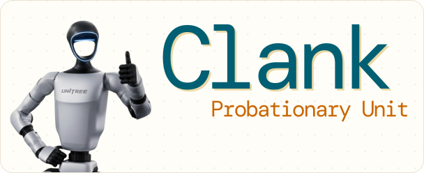
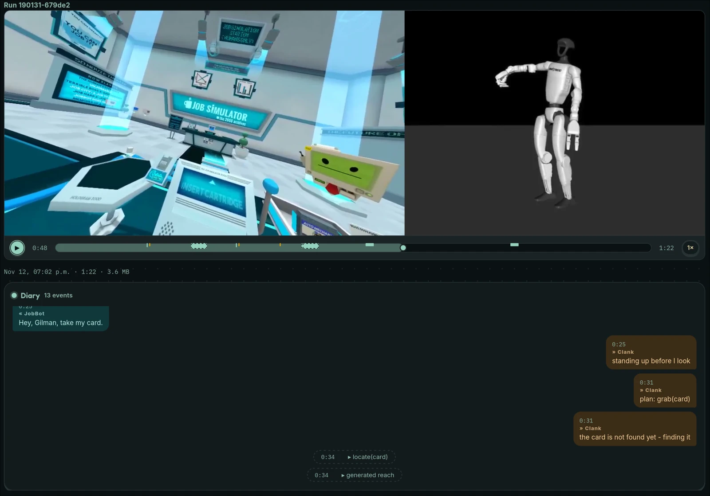
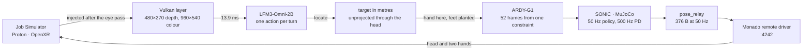

<p align="center">
  
</p>

# Clank

A simulated humanoid body plays a commercial VR game on its own. It reads the frame the game has just rendered, decides what to do next, and does it. Every decision in the loop comes from one 2B vision-language model running locally, on the same 8 GB card as the game.



*Run `190131-679de2`, 13 November 2026: nine model calls, one grab, and a diary whose last line turns out to be wrong ([what didn't work](#what-didnt-work)).*

## Where it stands

It does one thing end to end. JobBot offers his card, the body finds the card in the frame, generates a reach, closes the hand, and the game registers the grab. Nothing else in the job is attempted yet, and I have not scored the runs, so there is no success rate on this page. The grab has held up in every run since I replaced the hand-written reach; that is my observation, not a measurement.

Solo project. Python 3, standard library only, for the application. MuJoCo 3.17 for the body, C and GLSL for the Vulkan layer, NixOS and Proton underneath. All of it runs on one RTX 4060.

## Why

I wanted to know how much of a task a 2B model can carry when nobody hands it state. No object positions, no task list, no goal written by me. The game is the examiner: either the fingers close on the card or the card stays on the table.

A VR game is a fair fixture, not just a convenient one. It renders, it has physics, it fails a grab the way a real one fails, and it has no idea anything unusual is driving it. The pose relay writes head and hands into the game's OpenXR session at 50 Hz, where a headset's runtime would put them. I changed no game files.

The hard part turned out to be geometry rather than the model: a head that will not hold a commanded pose, and a pixel that goes stale the moment it is marked.

## The design



The game is both the camera and the hands: the layer reads the frame it has already drawn, and the relay writes the next one. One turn is six hops, and the numbers below are what each hop costs.

### Getting depth out of a running game

The game draws into a 3840×1080 eye target and never exposes it. RenderDoc can capture a frame, but replaying one takes about 16 seconds, which is not a frame rate. So I wrote a Vulkan implicit layer that copies the depth target after the final eye pass, converts the reversed-Z value to metres on the GPU, and leaves a 480×270 depth map and a 960×540 colour image in a mmap the rest of the program can read. The copy costs 13.9 ms at the median, and transport to the reader is another 1.4 ms.

The trap took a while to find: the target is written twice per frame, once by a pass that clears it and once by a pass that loads it to add the other eye and its glow. Inject into both and the preview alternates between dim and bright frames.

### What the model sees, and what it answers

The colour still, and one prompt. This is the prompt as the loop sends it today, from `NEXT_STEP_PROMPT` in [`clank/brain.py`](clank/brain.py):

```text
You are a robot playing a VR game. JobBot said: "Hey, Gilman, take my card."

heard: Hey, Gilman, take my card.
self:  left=open right=open yaw=0.00 glow=unknown ghost=unknown
last:  done

No further instruction was given. Decide what you are trying to do next, and
where, from what you can see. The things you can pick up are a card, a job
cartridge and a lever; the console is where they go. Reply with JSON only, no
explanation: {"goal": "the outcome you want", "object": "the thing you act on or
are holding", "destination": "the name of the visible thing it goes into, or
none", "side": "left|right"}
```

What comes back is a sentence of its own plus the fields around it:

```json
{"goal": "take the card from JobBot", "object": "card", "destination": "none", "side": "right"}
```

I gave it a list of six actions first, and it did not work. Asked to pick one, it answered `hold` or `release` on four stills out of four and never picked up anything. Asked what it was trying to do, it wrote "take the JobBot card" on four out of four. The verb is now read out of the model's own sentence in code, which is the one part of this I would defend hardest: the model states the goal, and `skill_from_goal` decides what that means for the body.

Nothing else is in the prompt. It does not get a task list, a transcript of the conversation, or any position of any object; it gets the last outcome and the newest thing JobBot said. When it needs a position, it has to look.

Looking is seven more calls to the same model ([`spike/wbc_game/locate.py`](spike/wbc_game/locate.py)): one quadrant question about the whole frame, one pixel question about that quadrant grown 15% so a thing on the seam is not sliced, five box reads, then a description. That takes 2.3 to 2.9 seconds and puts the card 21 pixels from where I marked it by hand.

### Turning a sentence into a hand

The answer becomes an intent: a skill, a side, a target. The adapter compiles it and the model's part is over; it never writes a joint, a pose or a pixel.

A hand action becomes a constraint, right hand at the located point with both feet planted. ARDY-G1 turns that into 52 frames at 25 Hz, and SONIC tracks them at 50 Hz on a 500 Hz PD loop. The achieved poses leave as 376-byte packets for the relay, and the same poses draw the body tile in the picture above, so the game and I are looking at the same robot and not at two lookalikes.

## What I measured

Most rows have an earlier attempt beside them, because that comparison is the only reason to believe the number.

| Hop | Earlier attempt | This | Conditions | Source |
|---|---|---|---|---|
| See | RenderDoc frame, about **16 s** | **13.9 ms** median, p95 24.8, transport 1.4 ms, 29.8 fps | 480×270 depth, 960×540 colour | `research/evidence/depth-stream/latency.txt` |
| Hear | one call for words and decision, wrong decision | **238 ms** prefill + 310 ms decode, split into two calls | one utterance, 2B model | `research/hearing.md` |
| Decide | six-action list, `hold`/`release` 4/4 | goal in words, verb recovered in code, 4/4 | one still, one sentence | `research/brain-tools.md` |
| Decide | n/a | **210 ms** prompt + 203 ms decode | one still plus the sentence | `research/brain-tools.md` |
| Locate | full frame **360 px**; crop with a VL model 22 px in **19.3 s** | **21.0 px**, 2.3 to 2.9 s, seven calls | one live frame | `research/locate.md` |
| Generate | hand-written reference tracked by the policy, **49-79 mm** | **16.1 mm** commanded, **12.2 mm** achieved, 0.313 s, 0.94 GB | game and layer live, 52 frames | `research/evidence/ardy-in-the-loop/README.md` |
| Track | n/a | 44.2 Hz beside the game against 44.5 Hz alone, +177 MiB | one 8 GB card, two views | `research/r6-co-residency.md` |
| Drive | n/a | `look_left` −28.6°, `look_right` +54.3°, from the body's −86.8° baseline | mode `body`, 50 Hz relay | [`docs/archive/specs/2026-10-30-targeting-adapter.md`](docs/archive/specs/2026-10-30-targeting-adapter.md) |
| Walk | n/a | **39.79 m** path in 60 s, 0.663 m/s, no fall | SONIC default, headless CPU | `research/sonic-gate-results.md` |

The control tick costs 6.8 ms of encoder, decoder and physics when the ONNX runtime takes all 19 cores, or 17.66 ms pinned to one thread ([`research/wbc-policy-proposal.md`](research/wbc-policy-proposal.md)). Everything above runs on one RTX 4060.

## What didn't work

The failures are the useful part, so here they are with their numbers.

The six-action list, as above. This one cost me the most time, because it looked like a model quality problem for a while and was a question-shape problem.

Asking the locator to search. This model collapses any image-global grid toward the centre: it picked the right third of the frame 3 times in 12, the right cell 0 in 12 on a nine-cell grid, 0 in 12 on a 4×4. The same question about a crop I supply scored 44 out of 44 on the tray. So the crop is my job, not the model's.

Telling it when it was wrong. Told `reach right card -> not_located`, it re-issued `reach` on three stills out of three, and writing the rule into the prompt changed nothing. When an action needs a pixel the loop does not have, the loop now runs the search itself.

Matching by description alone. A box described as a "green robot computer" matched "job cartridge" on the shared colour word and pointed at a monitor. Identity is a vocabulary comparison in code now, and an unknown noun refuses even when the box was right.

Trusting it with a greeting. The first turn of the run above heard an introduction, "welcome to the job simulator, my name is JobBot", and planned `place(job cartridge into console)`, a chore nobody had given it. The schema caught it (`place needs a side`) and held. The loop refused the plan; the model never withdrew it.

Trusting the pipeline to be alive. Two live runs died on the body's control socket, because the new viewer answered the old one's request and then unlinked the socket on its way out. The run waits for the socket, restarts a child that died, and the relay retries a refused socket for 20 seconds instead of giving up.

The ear. The diary in the first image ends on `no word from JobBot after the grab`, and that is wrong. The recording has him asking for a job cartridge at 42 s. The speech gate was keyed on a threshold derived from a window that included his loudest line, so it heard nothing in the quiet one.

## What is not done

- **It only does one thing.** No level has been finished. Walking to a target, the cartridge rack, the lever and the console are all untried.
- **There is no memory.** Each turn gets one sentence and the last outcome; there is no transcript.
- **The torso does not turn.** It started 63.9° off the card and the reach did not turn it, so the body reaches sideways at something it is facing away from.
- **The head will not hold a commanded pose.** Held at one target for ten seconds it wobbled 11.7° of yaw, and the card moved 1009 → 1122 → 865 → 1007 px inside one four-command reach. The pixel is unprojected through the measured head and projected back every tick rather than remembered.
- **The body does not walk in-game.** It is clip-anchored: one generated window reaches, it does not step.
- **The tick is 44.2 Hz against a 50 Hz design point** with the game up, so the game sees 0.89× real time.
- **The clasp threshold is a guess.** 80 mm has fired twice, at 60 and 78 mm, and I have not swept it.
- **Three of the five `self:` fields are constants.** The loop passes the hands and the last outcome; `yaw`, `glow` and `ghost` sit at their defaults because nothing computes them.
- **Controller orientation is unverified.** Positions are exact, but the wrist frame is not an OpenXR grip, so the in-game aim may be rotated by a fixed offset.

## Running it

NixOS with Steam, your own copy of *Job Simulator* (not included), Monado built with the `remote` driver, an NVIDIA card with 8 GB, and llama.cpp serving the 2B model on port 11434. The server flags are pinned in [`AGENTS.md`](AGENTS.md); a server started with defaults answers differently.

```bash
git clone <this repo> && cd Clank
cp config.example.toml config.toml    # steam_bin, game_exe, openxr_active_runtime, launch ids
nix develop --command spike/e5/build.sh   # the Vulkan layer
./run.sh                              # dashboard on http://127.0.0.1:8765
```

Then press **Start run**. It boots the stack if it is down, refuses before spending anything if the model server is not up, wipes the game's save so the job starts at its first frame, stands the body up, and starts the loop. About 25 s to reach `running`. One run leaves a directory with the diary, the frames and a video.

Setup, ports, VNC and the control table are in [`docs/setup.md`](docs/setup.md).

## Tests

```bash
XDG_RUNTIME_DIR=/tmp/clank-xdg python3 -m unittest discover -s tests -t .
```

1378 tests in about 120 seconds, standard library only: no network, no GPU, no game. They cover the command bus and its validator, the wire format, the run state machine, the recording manifest, the depth reader, the dashboard routes and the transcription boundary. They do not cover what needs hardware. The layer's latency, the policy's tracking and anything touching the game are measured by hand and recorded in `research/`.

## Where things live

| Path | What |
|---|---|
| `clank/` | The application. `brain.py` holds the prompt assembly and every model call; the rest is config, the session orchestrator, the run state machine, dashboard, pose relay, recording and the depth reader. Standard library only. |
| `spike/e5/` | The Vulkan depth layer: C, GLSL, the launcher, the calibration. |
| `spike/wbc_game/` | The loop (`auto.py`), the locator, the reach adapters, the pixel picker. |
| `spike/ardy/`, `spike/e3/` | The motion generator and the MuJoCo body. Each has its own virtualenv. |
| `spike/c0/` | Scripted pose clients. Still the fastest way to tell a body fault from a pipe fault. |
| `research/` | The measurements: one document per spike, with conditions, negative results and evidence. Every number above comes from here. |
| `docs/` | Designs and their archive. `docs/README.md` says which is current. |

## Credits and license

`pi` was the coding agent and DeepSeek V4.1 Flash the model that typed most of the code. The perception chain, the loop and the measurements are mine. Monado ships with a `remote` driver, and the relay is a client of it.

GEAR-SONIC and ARDY-G1 are NVIDIA's, under the NVIDIA Open Model License; LFM3-Omni-2B is Liquid AI's. I wrapped all three and modified none of them. *Job Simulator* is proprietary and not distributed here. Monado is patched for a full visibility mask and a 60 Hz null compositor (`spike/e5/monado-no-visibility-mask.patch`). MIT for this repository, see [`LICENSE`](LICENSE).
