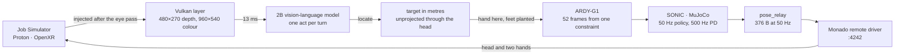

<p align="center">
  
</p>

# Clank

A Unitree G1 simulated in MuJoCo, playing *Job Simulator* through Monado with no headset, no controllers, and no game files touched. It sees the game through a Vulkan layer, decides with a local vision model, and moves with a generated motion prior.


*Run `190131-679de2`, 12 November 2026. The game's own view, the body that is driving it, and the diary underneath. JobBot says "Hey, Gilman, take my card"; the entries that follow are `plan: grab(card)`, the search for the card, `locate(card)` and `generated reach`. Nothing in that column was typed.*

## Why

A VR game already knows how to consume a head and two hands. Point a humanoid's pose at that interface and you get a task environment with real physics, real objects, and an opponent that does not know the player is simulated. That is why the game is here: it is the fixture, and it cannot be scripted.

Nothing about the interface is documented, and the game publishes no object positions, no state, no events. Everything the player knows comes from pixels, and from a depth buffer that is not exposed either. Most of this project is therefore measurement: a Vulkan layer inside the game's own render pass, a socket Monado will accept, a motion prior that turns one constraint into 52 frames, and a log of what was decided next to what actually happened.

The hard part is that the loop has no feedback except geometry. Held against one target for ten seconds, the head wobbled **11.7° of yaw**, so a pixel marked once goes stale inside a single reach. Measured, the card moved 1009 → 1122 → 865 → 1007 px during one four-command reach ([`research/reach-placement.md`](research/reach-placement.md)). The fix was to stop tracking the pixel: unproject the target through the measured head into metres, then project it back every tick.

## Stack and my role

Python 3.12 (standard library only) for the application in `clank/`; MuJoCo 3.17 and ONNX Runtime in the spikes, where one 20 ms control tick costs 17.66 ms of encoder, decoder and physics ([`research/wbc-policy-proposal.md`](research/wbc-policy-proposal.md)); one RTX 4060 with 8 GB; NixOS, Steam and Proton; Monado with its `remote` driver; a Vulkan layer in C and GLSL.

Solo project. I integrated rather than trained: **GEAR-SONIC** (whole-body control) and **ARDY-G1** (motion generation) are NVIDIA policies, run unmodified, and the model that plans is a 2B vision-language model served by llama.cpp. I designed the loop and the perception chain: depth buffer, unprojected to metres, projected back to a pixel. `pi` was the coding agent and DeepSeek V4.1 Flash the model that typed most of the code. Every claim below is backed by a test or a measurement in `research/`.

## Architecture



Read it as one turn of a loop rather than a pipeline. The game is both the sensor and the actuator: the layer reads the frame it has already rendered, and the pose relay writes the next one. There is one simulation. The achieved `mjData` poses go out as 376-byte packets, and the same poses draw the body tile in the image above, so the game and the operator are looking at the same robot rather than two lookalikes.

**Seeing.** The layer is injected after the final eye pass, reads the game's 3840×1080 reversed-Z depth and its colour target, and writes a 480×270 depth map in metres plus a 960×540 colour image into a seqlock-protected mmap. Same frame, twice:


**Deciding.** The model gets the still and the one sentence JobBot said, and returns one act. It never writes joints, poses or pixels; the vocabulary is fixed and the adapter compiles it.

**Moving.** An act becomes a constraint, right hand at the object with feet planted, and ARDY-G1 writes 52 frames at 25 Hz. SONIC tracks them at 50 Hz with a 500 Hz PD loop and ten frames of look-ahead. The clasp starts closing at 80 mm and the hand is pinned there afterwards. A root waypoint is designed for the out-of-reach case and has never been exercised.

## Decisions and tradeoffs

**Inject into the render pass, not a capture.** RenderDoc replays a frame in about 16 s; the layer costs 13 ms. The price is C and GLSL inside the game's render pass, and knowing that the target is written twice per frame, once by a clear pass and once by a load pass that adds the other eye and its glow. Only the load pass may be injected. Inject both and the preview alternates between dim and bright frames.

**Generate the reach instead of hand-writing and tracking it.** Hand-writing a reference and asking the policy to follow it left residuals of 49–79 mm, because the policy answers a reference with something of its own. A constraint into a motion prior gets 16.1 mm commanded and 12.2 mm achieved. The cost is a CUDA dependency, a right hand only, and a preflight that can refuse, so the scripted path still exists as the fallback.

**Relay the state file the viewer already writes.** A second pose client would have been easy and would have meant two simulations: the tile showing one body and the game another, and every screenshot a quiet lie. The relay is standard-library, reads `body_state.json`, and holds the last pose with a `stale` flag instead of freezing silently.

**A crop per turn, not a bigger locator per turn.** On a full frame, the grounded VL model found the card to 22 px where the 2B model was 360 px off, but the same crop took it 19.3 s against 0.73 s. The loop needs an answer per turn, so the 2B model stays on a crop it can read, and absence is decided in code because neither model can be trusted to refuse.

## Results

| Hop | Result | Conditions | Source |
|---|---|---|---|
| See | layer **13.9 ms** median, p95 24.8; transport 1.4 ms; 29.8 fps | 480×270 depth, 960×540 colour | `research/evidence/depth-stream/latency.txt` |
| Hear | **238 ms** prefill + 310 ms decode | one utterance, 2B model, llama.cpp | `research/hearing.md` |
| Decide | **210 ms** prompt + 203 ms decode | one still plus the sentence | `research/brain-tools.md` |
| Locate | card **21.0 px** (21 mm at 0.332 m), lever 5.9 px | one live frame, five box reads | `research/locate.md` |
| Generate | **16.1 mm** commanded, **12.2 mm** achieved on the glove, 0.313 s, 0.94 GB | game and depth layer live, 52 frames | `research/evidence/ardy-in-the-loop/README.md` |
| Drive the game | `look_left` **−28.6°**, `look_right` **+54.3°**, `hold` returns to ±0.8° | mode `body`, 50 Hz relay | `research/r6-co-residency.md` |
| Walk | **39.79 m** in 60 s, no fall | SONIC default, headless CPU | `research/sonic-gate-results.md` |
| Co-residency | **44.2 Hz** beside the game against 44.5 Hz alone, +177 MiB | one 8 GB card, two views | `research/r6-co-residency.md` |

## Limitations

- **Nobody has played it.** The body took a card and held it; no level has been cleared, and the run above ended with "no word from JobBot after the grab".
- **The body does not walk in-game.** It is clip-anchored: one generated window reaches, it does not step, so anything out of arm's reach is not attempted.
- **It runs at 44.2 Hz against a 50 Hz design point** with the game up. The tick advances exactly 20 ms of simulated time, so the shortfall is real: the game sees 0.89× real time.
- **The torso does not turn to look.** It started 63.9° off the card and the reach did not turn it, so the body reaches sideways at a target it is facing away from.
- **The clasp threshold is a guess.** 80 mm has fired twice, at 60 and 78 mm, and has never been swept either way.
- **The model is not reliable about its own tools.** One run planned `reach(the display interface)` again and again, located nothing, and never acted on the card; absence is therefore decided in code rather than by the model.
- **Controller orientation is unverified.** Positions are exact, but the wrist frame is not an OpenXR grip, so the in-game aim may be rotated by a fixed offset.

## Quick start

You need NixOS with Steam, your own copy of *Job Simulator* (not included, never will be), Monado built with the `remote` driver, an NVIDIA card with 8 GB, and llama.cpp serving the 2B model on port 11434. The model's flags matter and are pinned in [`AGENTS.md`](AGENTS.md); a server started with defaults answers differently.

```bash
git clone <this repo> && cd Clank
cp config.example.toml config.toml    # steam_bin, game_exe, openxr_active_runtime, launch ids
nix develop --command spike/e5/build.sh   # the Vulkan layer
./run.sh                              # dashboard on http://127.0.0.1:8765
```

Then press **Start run** in the dashboard. It boots the stack if it is down (Monado, Weston, websockify, Steam, the game), refuses before spending anything if the model server is not up, wipes the game's save so the job starts at its first frame, stands the body up, and starts the loop. One run costs about 25 s to reach `running`, and leaves a directory with the diary, the frames and a video.

Setup, ports, VNC and the full control table are in [`docs/setup.md`](docs/setup.md).

## Tests

```bash
XDG_RUNTIME_DIR=/tmp/clank-xdg python3 -m unittest discover -s tests -t .
```

**1378 tests in about 120 s**, standard library only: no network, no GPU, no game. They cover the command bus and its validator, the wire format, the run state machine, the recording manifest, the depth reader, the dashboard routes and the transcription boundary. They do not cover the parts that need hardware: the layer's latency, the policy's tracking, and anything that touches the game are measured by hand and recorded in `research/`.

Without a GPU or a copy of the game, the tests and `research/evidence/` are the offline path.

## Where things live

| Path | What |
|---|---|
| `clank/` | The application. Config, session orchestrator, run state machine, dashboard, pose relay, recording, depth reader, the model loop. Standard library only. |
| `spike/e5/` | The Vulkan depth layer: C, GLSL, the launcher, the calibration. |
| `spike/wbc_game/` | The loop (`auto.py`), the locator, the reach adapters, the pixel picker. |
| `spike/ardy/`, `spike/e3/` | The motion generator and the MuJoCo body. Each has its own virtualenv. |
| `spike/c0/` | The scripted pose clients, still the fastest way to tell a body fault from a pipe fault. |
| `research/` | The measurements: one document per spike, with conditions, negative results and evidence images. Every number above comes from here. |
| `docs/` | Designs and their archive. `docs/README.md` says which is current. |
| `tests/` | The suite. |

## License and credits

MIT for this repository, see [`LICENSE`](LICENSE). *Job Simulator* is proprietary and not distributed here. GEAR-SONIC and ARDY-G1 are NVIDIA's, under the NVIDIA Open Model License; they are wrapped, not modified. Monado is patched for a full visibility mask and a 60 Hz null compositor (`spike/e5/monado-no-visibility-mask.patch`).
